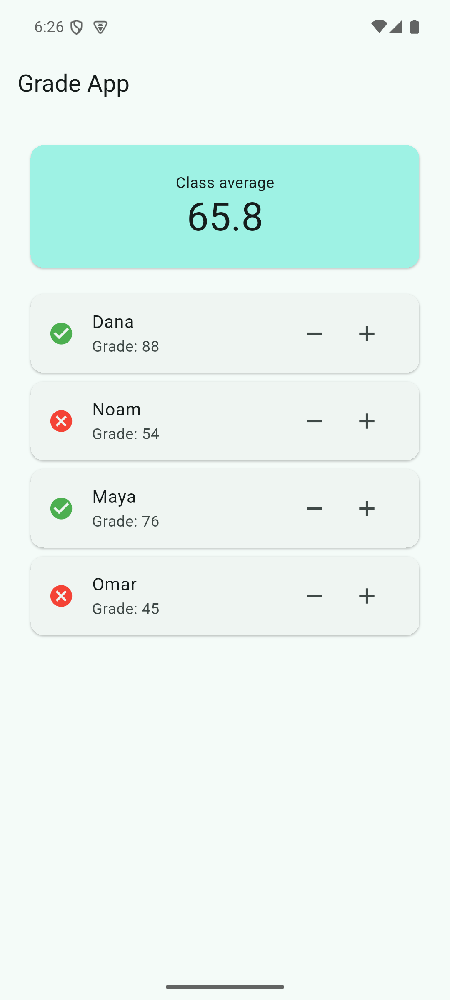

# Flutter Practice 4 — Grade App

An independent academic Flutter application matching the Practice 4 reference:

- Four sample students and grades
- Class average displayed at the top
- Green checkmarks for passing grades and red X icons for failing grades
- Plus and minus buttons for every student
- Automatic grade, status, and average updates through `setState`

The passing threshold is assumed to be 60 because it was not specified in the
provided overview. This implementation was created with AI assistance and
should be disclosed as such when submitted.

## Android screenshot



## Run and verify

```text
flutter pub get
flutter analyze
flutter test
flutter run
```

The application has its own `pubspec.yaml` and can be shared as a standalone
repository without any PastVoy production files.

## Verified results

- `dart format --output=none --set-exit-if-changed lib test` — PASS
- `flutter analyze` — PASS, no issues found
- `flutter test` — PASS, all tests passed
- Android API 35 emulator launch — PASS
